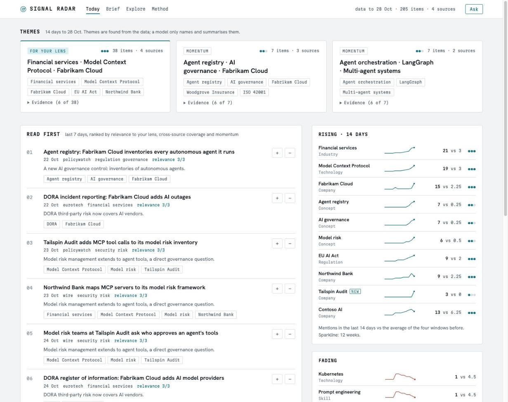
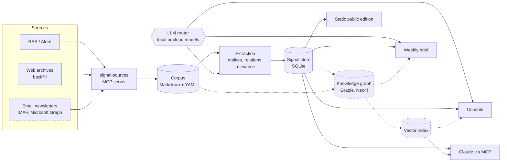
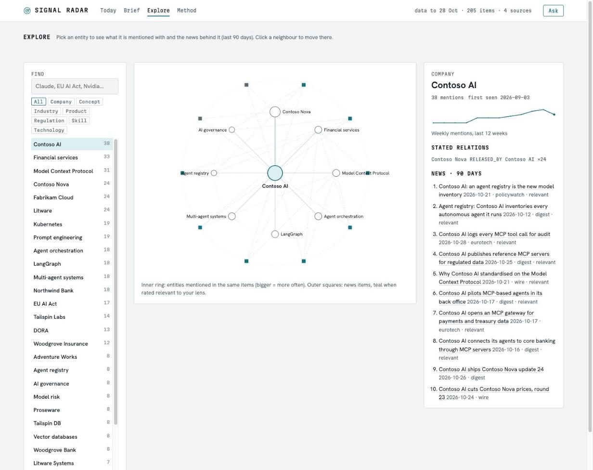
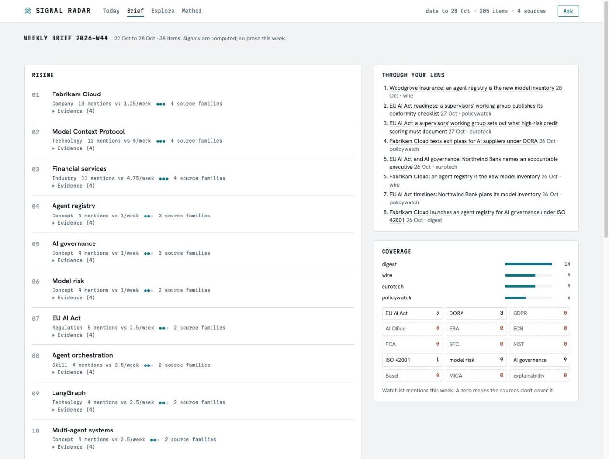

# Signal Radar

**Turn your AI and tech news intake into market signals you can act on.**

Signal Radar reads the newsletters and feeds you already follow, builds a knowledge graph and a time-series signal
store from them, and tells you what is gaining momentum, what is new, what is fading, and what that means for your
work. Every signal carries its evidence (the articles behind it) and a confidence level. It runs on your laptop with
a local model; cloud models are optional, capped and logged.

**[Project page](https://jpshetty-ai.github.io/signal-radar-community/)** ·
**[Live demo](https://jpshetty-ai.github.io/signal-radar-community/demo/)** (synthetic data) ·
[Architecture](docs/architecture.md) · [Decision records](docs/adr/) · [Build log](docs/phases.md)



<sub>Screens show the bundled demo: fictional companies and headlines generated by `scripts/demo.py`.</sub>

## What it answers

| | Question | How |
|---|---|---|
| Rising | What is gaining momentum? | Weekly mentions against each entity's own baseline, confirmed by independent source families |
| New | What just appeared? | First-seen entities, and entity pairs that start appearing in the same stories (clusters forming) |
| Fading | What is losing attention? | Entities dropping below their trend |
| Lens | What matters to me? | Every item scored 0 to 3 against a reader profile you write in plain text |
| Learn | What should I learn? | Skills rising across sources, with one concrete learning project each |
| Build | What should I create? | Product, service and content ideas tied to the signals that justify them |

## Architecture

Solid boxes run in every install. Dashed boxes are optional tiers you turn on when you want them.



The corpus is the source of truth; the signal store, graph and vectors are derived and can be rebuilt at any time.
Code computes the signals (counts, velocity, clusters); models only classify items and write prose, and any cited
item id a model invents is removed before you see it.

| Tier | What it adds | Turn it on |
|---|---|---|
| **Core** | Sources, MCP server, corpus, extraction, signal store, console, weekly brief, public edition, Claude via MCP | Default install plus one model, local or cloud |
| Knowledge graph | Graph of documents, entities and relations | `pip install -e '.[graph]'` |
| Neo4j | Served graph; story clusters and lens links in the brief | Graph tier plus `connector: neo4j` in `config/graph.yaml` |
| Vector search | Hybrid Ask, `semantic_search`, `signal-radar search` | Graph tier plus `pip install -e '.[vectors]'` |
| Email, scheduling, publishing | Newsletters from your mailbox, daily runs, a hosted public edition | See below and [docs/architecture.md](docs/architecture.md) |

Without the optional tiers nothing breaks: Explore draws its graph from the signal store, the brief clusters
co-mentioned entity pairs, and Ask uses keyword search.

## Components

| Component | Where | What it does | Decision |
|---|---|---|---|
| MCP server | [`mcp_server.py`](src/signal_radar/mcp_server.py) | Official `mcp` SDK 2.x, stdio. 13 typed tools (`top_movers`, `trend_metrics`, `emerging_clusters`, `reading_list`, `semantic_search`, `run_ingest`, `subscribe_source`, ...), resources `corpus://items/{id}` and `corpus://digest/{date}`, prompts `weekly_signal_brief`, `learning_radar`, `content_ideas` | [ADR-0005](docs/adr/0005-mcp-sdk-v2.md) |
| Source adapters | [`sources/`](src/signal_radar/sources/) | One interface, `fetch(since) -> list[Item]`. Gmail over IMAP (read-only), Microsoft 365 over Graph, RSS/Atom, web-archive backfill, per-newsletter parsers. Subscribe by config, no code change | [ADR-0004](docs/adr/0004-source-subscriptions.md), [0007](docs/adr/0007-m365-mail-via-graph.md), [0008](docs/adr/0008-gmail-imap-and-alphasignal.md), [0012](docs/adr/0012-rss-adapter-european-sources.md) |
| Corpus | [`corpus.py`](src/signal_radar/corpus.py) | One Markdown file per item with YAML frontmatter. Summaries and links only, never full articles. Idempotent (url + title hash) | [ADR-0009](docs/adr/0009-corpus-ingest-backfill.md) |
| LLM router | [`llm.py`](src/signal_radar/llm.py) | Roles (`extraction`, `reasoning`, `writing`, `embedding`) mapped to models in [`config/models.yaml`](config/models.yaml). Local (Ollama, LM Studio, llama.cpp, vLLM, Jan) or cloud (Anthropic, OpenAI, OpenRouter). Ranked fallbacks, `cheapest_passing` selection, monthly budget cap, per-call log of tokens and cost | [ADR-0002](docs/adr/0002-llm-router.md), [0006](docs/adr/0006-call-log-sqlite.md), [0013](docs/adr/0013-model-selection.md) |
| Extraction | [`extract.py`](src/signal_radar/extract.py) | Schema-checked JSON from a local model: category, relevance to your lens, entities (8 types), relations (7 types). Resumable, cached by input hash. Aliases fold spellings into one entity | [ADR-0010](docs/adr/0010-extraction-signal-store.md) |
| Signal store | [`signals.py`](src/signal_radar/signals.py) | SQLite: weekly mentions, velocity, novelty, co-occurrence growth, confidence from source families, watchlist blind spots | [ADR-0010](docs/adr/0010-extraction-signal-store.md), [0018](docs/adr/0018-graph-signals.md) |
| Knowledge graph (optional) | [`graph_export.py`](src/signal_radar/graph_export.py), [`graph_sync.py`](src/signal_radar/graph_sync.py), [`graph_signals.py`](src/signal_radar/graph_signals.py) | Graqle graph file, optionally mirrored into Neo4j (restricted user, delete guard) for story clusters and lens links | [ADR-0003](docs/adr/0003-graqle-config-generated.md), [0017](docs/adr/0017-neo4j-graph-store.md) |
| Vector search (optional) | [`vectors.py`](src/signal_radar/vectors.py) | In-process ONNX embeddings (384-dim), cached by text hash, bounded per run. When on, Ask is hybrid: keyword plus vector, reciprocal rank fusion | [ADR-0019](docs/adr/0019-vector-search.md) |
| Console and site | [`site/`](src/signal_radar/site/) | Static-first: JSON data plus templates. Today, Brief, Explore (radial ego graph), Method (every number explained). Local console adds Ask and feedback | [ADR-0011](docs/adr/0011-static-first-site.md) |
| Weekly brief | [`brief.py`](src/signal_radar/brief.py) | Top movers, emerging entities, fading topics, forming clusters, each with evidence, confidence and a "so what for me" line | |
| Model evaluation | [`evals.py`](src/signal_radar/evals.py), [`judges.py`](src/signal_radar/judges.py) | Candidates measured on this project's own tasks: LLM-as-judge and blind human grading sheets | [ADR-0013](docs/adr/0013-model-selection.md) |
| Operations | [`schedule.py`](src/signal_radar/schedule.py), [`publish.py`](src/signal_radar/publish.py) | launchd daily run with catch-up after sleep; optional publishing of a public edition behind Cloudflare Access | [ADR-0014](docs/adr/0014-hosting-public-edition.md), [0015](docs/adr/0015-alphasignal-terms-compliance.md) |

<table><tr>
<td width="50%"><br><sub><b>Explore.</b> Neighbours, relations, trend and articles for any entity.</sub></td>
<td width="50%"><br><sub><b>Weekly brief.</b> Signals with evidence, the week through your lens, blind spots.</sub></td>
</tr></table>

## Quickstart

### 1. Try the demo (no mailbox, no API key, no model)

```bash
git clone https://github.com/jpshetty-ai/signal-radar-community
cd signal-radar-community
python3 -m venv .venv && source .venv/bin/activate     # Python 3.11+
pip install -e '.[mcp,web,dev]'
python scripts/demo.py --serve                         # http://127.0.0.1:8765
```

The demo writes about 200 synthetic items into `demo/` and runs the real pipeline over them: extraction (with
canned answers in place of a model), signal store, weekly brief, console and public site.

### 2. Run your own radar

```bash
pip install -e '.[mcp,web,dev]'        # add anthropic / openai if you use those providers (OpenRouter uses openai)
cp .env.example .env                   # keys only for the cloud models you pick
ollama pull qwen3:8b                   # the default local model; skip if you choose another (next section)
signal-radar config                    # validate config, show which model each role uses
signal-radar llm extraction "ping"     # smoke test the extraction model
signal-radar daily                     # ingest + extract + signals + brief + site
signal-radar web                       # console on http://127.0.0.1:8765
pytest
```

Out of the box it reads public feeds that need no account (EU AI Act Newsletter, Sifted, Tech.eu, European
Commission digital strategy). Then make it yours:

- **Your lens:** edit `lens`, `watchlist` and `lens_targets` in [`config/taxonomy.yaml`](config/taxonomy.yaml), then
  `signal-radar extract --redo`. The shipped lens is the author's (financial services, risk, EU AI Act).
- **Your sources:** add feeds in [`config/sources.yaml`](config/sources.yaml), or ask Claude to call
  `subscribe_source` through the MCP server.
- **Optional tiers:** knowledge graph, Neo4j and vector search, as in the tier table above.

### Choose your models

Every model call goes through one router, and [`config/models.yaml`](config/models.yaml) decides which model does
each job. The default is fully local (Ollama, nothing leaves your machine). To use something else, put another
catalog id in a role:

```yaml
roles:
  extraction:
    candidates: [anthropic-haiku]     # was [local]
  reasoning:
    candidates: [anthropic-sonnet]
  writing:
    candidates: [anthropic-sonnet, local]   # tried in order: falls back to local if the first fails
```

| Catalog id | Runs on | Needs |
|---|---|---|
| `local` | Ollama, qwen3:8b (default) | `ollama pull qwen3:8b` |
| `local-server` | LM Studio, llama.cpp, vLLM, Jan: any OpenAI-compatible server on your machine | The server running; set its port and model name in `models.yaml`. No key |
| `anthropic-haiku`, `anthropic-sonnet` | Anthropic API (Claude Haiku 5.5, Claude Sonnet 5.5) | `ANTHROPIC_API_KEY`, `pip install -e '.[anthropic]'` |
| `openai-luna` | OpenAI API | `OPENAI_API_KEY`, `pip install -e '.[openai]'` |
| `openrouter-luna`, `openrouter-sonnet` | OpenRouter: hundreds of models with one key, no-retention endpoints only | `OPENROUTER_API_KEY`, `pip install -e '.[openai]'` |

Add your own entries to the catalog: any Ollama model, any OpenRouter id, any model your local server loads.
Extraction is the high-volume job: about 1,100 input and 200 output tokens per item, so roughly $0.0003 per item
with Claude Haiku 5.5, or 3 cents for a 100-item day. Paid calls stop at the monthly `budget` in the same file.

Try a model for one run without editing anything, then compare runs on identical inputs:

```bash
signal-radar --model extraction=@anthropic-haiku extract --limit 5
signal-radar --model writing=anthropic/claude-sonnet-5-5 brief     # any model by name
signal-radar compare                                               # same inputs, different models: tokens, cost
signal-radar models eval --judge anthropic-sonnet                  # score candidates on your own tasks (asks first)
```

If you use the knowledge graph, run `python scripts/sync_graqle_config.py` after changing models.

### 3. Use it from Claude

```bash
claude mcp add signal-sources -- "$PWD/.venv/bin/signal-sources-mcp"
```

Then ask, for example, "What is rising this week, and what is the evidence?" or run the `weekly_signal_brief`
prompt. See [`.mcp.json.example`](.mcp.json.example) for a project-scoped config.

### Email newsletters (optional)

Email sources ship disabled in `config/sources.yaml`. To read newsletters from Gmail:

1. Gmail filter, for example `from:(tldrnewsletter.com OR alphasignal.ai)` -> label `Newsletters`.
2. Google account: 2-Step Verification on; create an app password at myaccount.google.com/apppasswords.
3. Store it in the keychain: `security add-generic-password -s signal-radar-imap -a you@gmail.com -w`.
4. `IMAP_GMAIL_USER=you@gmail.com` in `.env`, test with `signal-radar auth gmail`, set `enabled: true` on the source.

Microsoft 365 mailboxes work through Graph with a one-time device-code sign-in (`signal-radar auth work`,
[ADR-0007](docs/adr/0007-m365-mail-via-graph.md)). Credentials never live in config or Git, only env var names and
keychain entries. Check each publisher's terms before you publish anything derived from their newsletters
([ADR-0015](docs/adr/0015-alphasignal-terms-compliance.md)).

## Commands

```bash
signal-radar fetch <source> --days 2          # fetch one source, print items (writes nothing)
signal-radar ingest                           # all enabled sources since their cursor -> corpus/
signal-radar backfill tldr_ai --days 90       # history from a public web archive (polite, cached)
signal-radar extract                          # extraction for new items (resumable)
signal-radar signals rebuild                  # signal store from corpus + extractions (no LLM calls)
signal-radar signals movers --days 7          # rising entities (--down for fading, --type Company)
signal-radar signals trend "EU AI Act"        # one entity over time, related entities, evidence
signal-radar signals clusters --days 14       # entity pairs co-mentioned more often
signal-radar signals reading --days 7         # what to read, ranked for your lens
signal-radar graph                            # build the knowledge graph (needs the graph extra)
signal-radar search "agent governance"        # vector search over items and entities
signal-radar brief                            # weekly signal brief -> briefs/<week>.md + console
signal-radar web                              # local console
signal-radar models eval --judge <model>      # measure candidate models on your own tasks (asks before spending)
signal-radar models report                    # last evaluation, outputs side by side
signal-radar compare                          # models compared on identical inputs, from the call log
signal-radar site build --edition public      # static public edition (no newsletter text)
signal-radar schedule install daily --at 07:30   # run daily with launchd (macOS)
signal-sources-mcp                            # the MCP server (stdio)
```

## Layout

| Path | What |
|---|---|
| `config/models.yaml` | Roles -> provider/model/params, price table, budget. The only place model names live. |
| `config/sources.yaml` | Subscriptions: newsletters, feeds, web archives. No credentials. |
| `config/taxonomy.yaml` | Categories, your relevance lens, watchlist, ontology. |
| `config/aliases.yaml` | Entity spellings -> canonical name. |
| `config/graph.yaml` | Graph file or Neo4j, sync and embedding budgets. |
| `config/publish.yaml` | Optional hosting of the public edition (Cloudflare Pages + Access). |
| `graqle.yaml` | Generated from `models.yaml` and `graph.yaml`. Do not edit. |
| `src/signal_radar/` | The package: router, adapters, MCP server, extraction, signals, graph, site. |
| `corpus/`, `briefs/`, `data/` | Your instance (Git-ignored here): items, briefs, signal store, call log, graph. |
| `scripts/demo.py` | Synthetic demo instance in `demo/`. |
| `docs/` | Architecture, 18 ADRs, build log, project page. |

## How it was built

In phases, each finished and tested before the next, with a decision record for every design choice and an honest
build log of what works, what is untested and the known gaps ([docs/phases.md](docs/phases.md)). This community
edition is a clean copy of the author's private instance: same code, without the personal corpus and settings.

## License

[PolyForm Noncommercial 1.0.0](LICENSE): free for personal use, research, education and non-profit organisations.
For commercial use, contact the author.

## Author

Designed and built by **Jay Shetty**, enterprise, data and AI architect working with financial services on risk,
compliance, AI governance and the EU AI Act. [github.com/jpshetty-ai](https://github.com/jpshetty-ai)
