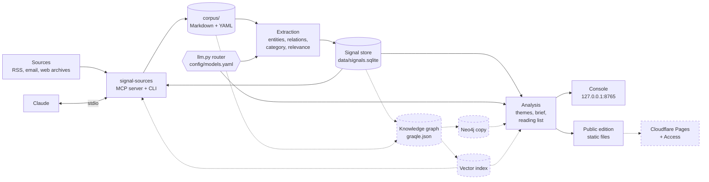
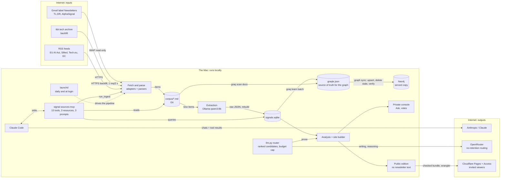

# Architecture

## Core and optional parts

A default install runs the core: everything needed to go from your sources to signals, a console, a weekly brief
and Claude access. The other parts add depth and are turned on one at a time.

| Tier | What you get | How to turn it on |
|---|---|---|
| **Core** (default) | Source adapters, MCP server, corpus, extraction, SQLite signal store (trends, novelty, clusters as co-mentioned entity pairs), console (Today, Brief, Explore, Method), weekly brief, static public edition, Claude via MCP | `pip install -e '.[mcp,web]'` plus one model: local Ollama by default, or any provider in [`config/models.yaml`](../config/models.yaml) |
| Knowledge graph | Graqle graph file of documents, entities and relations; graph queries through `graq` | `pip install -e '.[graph]'` |
| Neo4j | Served copy of the graph; story clusters and lens links in the weekly brief (ADR-0018) | Graph tier, a Neo4j database, `connector: neo4j` in [`config/graph.yaml`](../config/graph.yaml) (ADR-0017) |
| Vector search | Hybrid Ask (keyword plus vector), MCP `semantic_search`, `signal-radar search` | Graph tier and `pip install -e '.[vectors]'`; vectors are stored in Neo4j when it is on, else searched locally (ADR-0019) |
| Email newsletters | Gmail over IMAP, Microsoft 365 over Graph | Mailbox setup in the README, `enabled: true` in [`config/sources.yaml`](../config/sources.yaml) |
| Scheduling | Daily run with catch-up after sleep | macOS launchd: `signal-radar schedule install daily` |
| Publishing | Public edition on Cloudflare Pages behind Access | [`config/publish.yaml`](../config/publish.yaml) and [hosting.md](hosting.md) (ADR-0014) |

Without the optional tiers nothing breaks: Explore draws its graph from the signal store, the brief uses entity
pairs for clusters, and Ask uses keyword retrieval.

## Flow

Solid: core. Dashed: optional.

The corpus is the source of truth. The signal store, graph, Neo4j copy and vectors are derived and can be rebuilt
from it at any time.

## What leaves your machine

Besides fetching your sources, nothing, with the default configuration. Data leaves only through choices you make:

- **A cloud model** in `config/models.yaml`: the prompts for that role (item titles, summaries, entity lists) go
  to that provider. OpenRouter is configured for no-retention endpoints only.
- **Claude via MCP**: what the MCP tools return becomes part of your Claude conversation.
- **Publishing**: the checked public bundle goes to Cloudflare Pages behind Access (ADR-0014).

## Daily run (`signal-radar daily`)

ingest -> extract new items -> rebuild signal store -> graph build -> Neo4j sync -> embed new texts -> weekly
brief (first run of each ISO week) -> console and public site -> publish.

Steps for optional parts that are not installed or not configured report why in the run summary and do not fail
the run. The run fails only when a source fails, or when a configured Neo4j sync or publish fails.

## Components and why they exist

| Component | Responsibility | Why separate |
|---|---|---|
| signal-sources-mcp | Fetch, normalise, dedupe, write corpus; expose tools, resources and prompts | One integration point for Claude and for scheduled jobs |
| Corpus | Durable, diffable record of what was seen | Rebuild every derived store from it at any time |
| `llm.py` | Role-based routing to ranked candidates, fall-through, budget cap, cost log | Models change monthly; code should not |
| Signal store | Time series: weekly counts, velocity, novelty, co-occurrence growth | Graphs do not do time-series trend maths |
| Graqle (optional) | Graph of documents, entities, relations; graph reasoning via its MCP server | Relationship queries ("what does X enable in banking?") |
| Model evaluation (`evals.py`) | Grades candidates on this project's own tasks, with LLM and blind human judges | Pick the cheapest model that is good enough, on evidence |
| Analysis + site | Themes, weekly brief, reading list; console and public editions | Numbers are computed; the model only writes prose around them |
| Publish (`publish.py`, optional) | Bundle check, Cloudflare Pages upload, Access check and probe | A public edition must never be reachable without a login |

## Model roles

Every role is configured in [`config/models.yaml`](../config/models.yaml); the top of that file explains the
choices. Defaults are fully local.

| Role | Default | Volume | Notes |
|---|---|---|---|
| extraction | `local`: Ollama qwen3:8b | every item | Schema-constrained JSON, temperature 0, free to re-run. About 1,100 input and 200 output tokens per item |
| reasoning | `local` | per question in Ask | Swap for a cloud model for better answers |
| writing | `local` | daily themes, weekly brief | The author's blind-graded evaluation: local 0.74, cheap cloud models 0.86 to 0.92, Sonnet 0.95 |
| embedding | fastembed BAAI/bge-small-en-v1.5 (384 dims, in-process) | every item and entity | Vector search tier only (ADR-0019); Graqle keeps its own (ADR-0003) |

Choices: Ollama (any model), any OpenAI-compatible server on your machine (LM Studio, llama.cpp, vLLM, Jan),
Anthropic, OpenAI, OpenRouter. Roles can list several candidates tried in order, and `cheapest_passing` ranks them
by your own evaluation results (ADR-0013).

## Data stores

| Store | Location | In Git |
|---|---|---|
| Corpus | `corpus/` | no by default here (third-party summaries; see `.gitignore`), yes in a private repo |
| Config | `config/`, `graqle.yaml` | yes |
| Signal store | `data/signals.sqlite` | no (rebuildable from corpus) |
| LLM call log | `data/llm_calls.sqlite` | no |
| Weekly briefs | `briefs/<week>.md` (+ `data/briefs/`) | as the corpus |
| Graph build (optional) | `data/graqle/graqle.json` | no (rebuildable) |
| Graph served (optional) | Neo4j database named in `config/graph.yaml` | no (synced from the file) |
| Vectors (optional) | `data/vectors.sqlite`, plus a Neo4j index when Neo4j is on | no (cached by text hash) |
| Public signal store | `data/signals_public.sqlite` (without excluded sources) | no |
| Model evaluation | `data/model_eval/` | no |
| Viewer list (optional) | `config/viewers.txt` | no |

## Example: the author's full deployment

The author's own instance runs every tier on one Mac: newsletters from Gmail plus European RSS feeds, extraction
on local Ollama, writing and reasoning through OpenRouter after an evaluation run, the graph served from Neo4j
Desktop, vector search, a launchd job every morning, and a public edition for invited readers on Cloudflare.

AlphaSignal is read from the email only and never fetched or published (ADR-0015).
