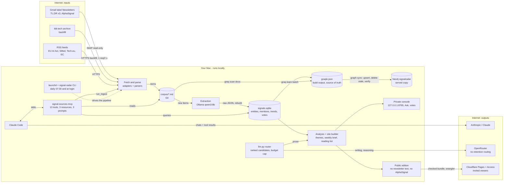

# Architecture

## Flow

Three paths leave the Mac: Claude Code conversations (including what MCP tools return) go to Anthropic; writing
and reasoning prompts go to OpenRouter once a cloud model is chosen (ADR-0013; until then they fall back to the
local model); the checked public bundle goes to Cloudflare Pages behind Access (ADR-0014). AlphaSignal is read
from the email only and never fetched or published (ADR-0015).

## Daily run (`signal-radar daily`, launchd)

ingest -> extract new items -> rebuild signal store -> graph -> console and public site -> deploy (bundle check,
upload, anonymous probe must get a login). Weekly, by hand for now: `signal-radar brief`.

## Components and why they exist

| Component | Responsibility | Why separate |
|---|---|---|
| signal-sources-mcp | Fetch, normalise, dedupe, write corpus; expose tools/resources/prompts | One integration point for Claude and for scheduled jobs |
| Corpus | Durable, diffable record of what was seen | Rebuild graph and store from it at any time; Git gives history |
| Graqle | Graph of documents, entities, relations; graph reasoning via its MCP server | Relationship queries ("what does X enable in banking?") |
| Signal store | Time series: weekly counts, velocity, novelty, co-occurrence growth | Graqle has no time-series trend maths |
| `llm.py` | Role-based routing to ranked candidates, fall-through, budget cap, cost log | Models change monthly; code should not |
| Model evaluation (`evals.py`) | Grades candidates on our own tasks, with Jev and blind judges | Pick the cheapest model that is good enough, on evidence |
| Analysis + site | Themes, weekly brief, reading list; console and public editions | Numbers are computed; the model only writes prose around them |
| Publish (`publish.py`) | Bundle check, Cloudflare Pages upload, Access check and probe | A public edition must never be reachable without a login |

## Model roles

| Role | Default | Volume | Notes |
|---|---|---|---|
| extraction | ollama/qwen3:8b | every item | Schema-constrained JSON, temperature 0, free to re-run |
| reasoning | cheapest passing candidate (MiMo, GLM, DeepSeek, GPT-6 Luna via OpenRouter), then local | weekly | `min_quality` 0.85 from `models eval` |
| writing | same candidates | daily themes, weekly brief | Local model until the first evaluation run |
| embedding | fastembed/BAAI/bge-small-en-v1.5 (384 dims, in-process) | every item and entity | Vector search in Neo4j and hybrid Ask (ADR-0019); Graqle keeps its own (ADR-0003) |

## Data stores

| Store | Location | In Git |
|---|---|---|
| Corpus | `corpus/` | yes |
| Config | `config/`, `graqle.yaml` | yes |
| Graqle graph (build) | `data/graqle/graqle.json` | no (rebuildable) |
| Graqle graph (served) | Neo4j `signalradar` on `localhost:7687`, user `signal_radar` (ADR-0017) | no (synced from the file daily) |
| Signal store | `data/signals.sqlite` | no (rebuildable from corpus) |
| LLM call log | `data/llm_calls.sqlite` | no |
| Public signal store | `data/signals_public.sqlite` (without excluded sources) | no |
| Weekly briefs | `briefs/<week>.md` (+ `data/briefs/`) | yes (Markdown) |
| Model evaluation | `data/model_eval/` | no |
| Viewer list | `config/viewers.txt` | no |
